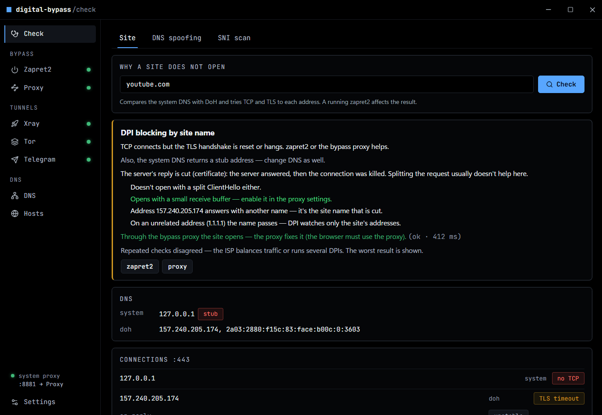
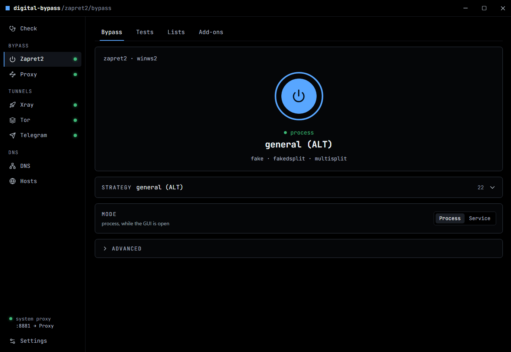
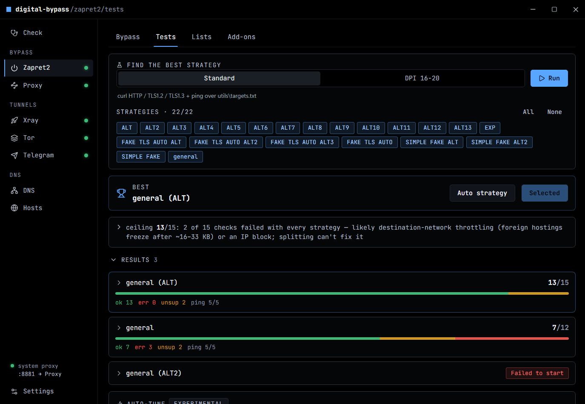
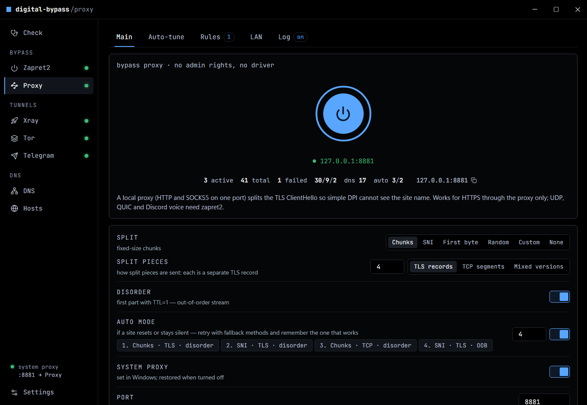
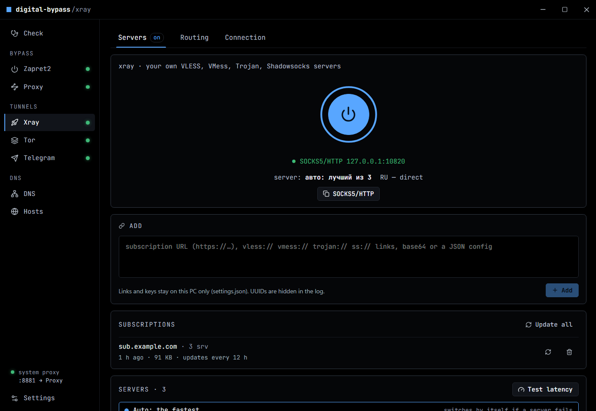
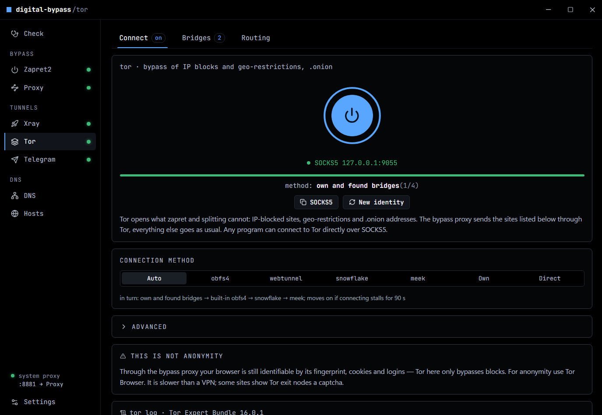
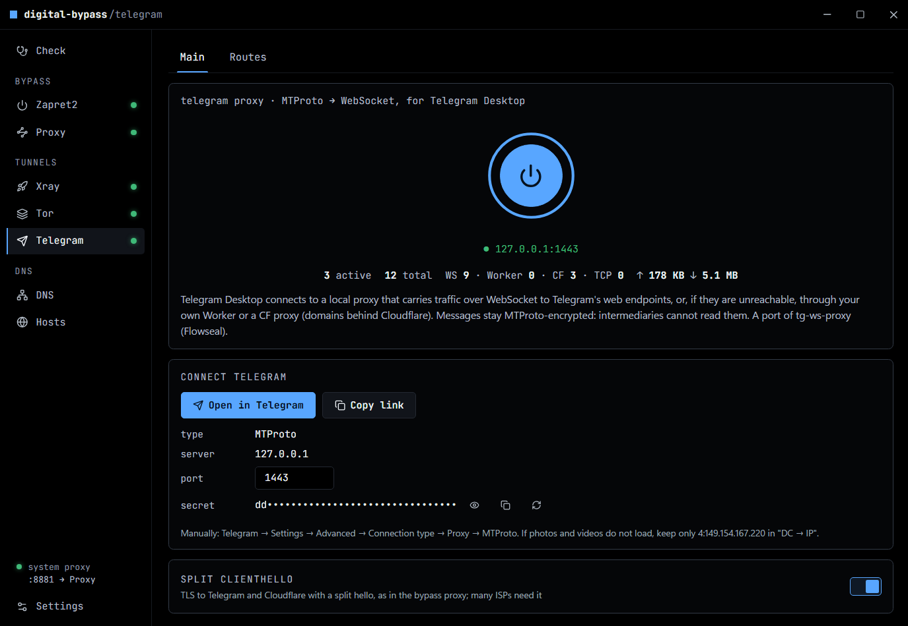
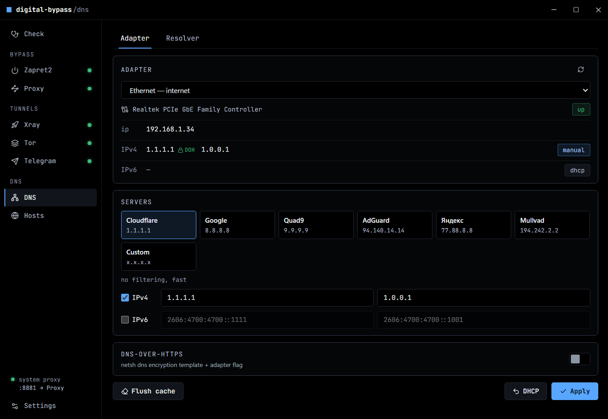

<div align="center">


# digital-bypass

**A network unblocking multitool for Windows**

One-click zapret2 (winws2 + Lua), a bypass proxy without admin rights, DNS switching and DoH, a "why won't it open" check, hosts.

[Русский](README.md) · **English**


[](https://claude.com/claude-code)

</div>

> Based on [Zapret2-RustGUI](https://github.com/digital-bombyx/Zapret2-RustGUI): its features became the `zapret2` module of this multitool.

## Screenshots

Checking a site, then bypassing with zapret2 and with the bypass proxy — 22 seconds (captions in Russian):

https://github.com/user-attachments/assets/5298f432-b7dd-4a0d-b7e6-1d6b9afa2764

| | |
|:-:|:-:|
| <a href="docs/screenshots/en/check.png"></a><br/><b>Check</b> — why a site does not open | <a href="docs/screenshots/en/zapret2.png"></a><br/><b>Zapret2</b> — one-click bypass |
| <a href="docs/screenshots/en/tests.png"></a><br/><b>Tests</b> — strategy finder | <a href="docs/screenshots/en/proxy.png"></a><br/><b>Proxy</b> — no admin rights |
| <a href="docs/screenshots/en/xray.png"></a><br/><b>Xray</b> — your servers and subscriptions | <a href="docs/screenshots/en/tor.png"></a><br/><b>Tor</b> — bridges and routing |
| <a href="docs/screenshots/en/telegram.png"></a><br/><b>Telegram</b> — a proxy for Telegram Desktop | <a href="docs/screenshots/en/dns.png"></a><br/><b>DNS</b> — adapter DNS and DoH |

## Modules

### zapret2

- **Bundled zapret-discord-youtube.** Ships inside the installer, your lists and settings survive updates. A custom folder is supported.
- **One-click bypass.** `winws2.exe` runs directly, without a console: as a process (while the app is open) or as the `zapret` service, compatible with `service.bat`.
- **Strategies as-is.** Arguments are read straight from `general*.bat`.
- **Strategy tests** modelled on `utils\test zapret.ps1`: HTTP / TLS 1.2 / TLS 1.3 + ping and the "16-20 KB" DPI test, best pick and history.
- **Strategy auto-tune** (experimental, inspired by [Geneva](https://geneva.cs.umd.edu/)): the best strategies are mutated (technique, `pos`, `seqovl`, `repeats`, fooling, fake — values come from the bundled strategies), each candidate is checked by the tester twice with the worst result counted, the simpler one wins a tie. The best one, if it beats the seeds, is saved as `general (AUTO N).bat`. It is a simplified local search, not a full genetic algorithm: no crossover and no population.
- **38 more strategies** from the [kinlay0](https://github.com/kinlay0/zapret2-discord-youtube-strats) collection (prefixed "K-") — tested and picked alongside the Flowseal ones.
- **Auto strategy**: the best strategies of a test are combined into one where winws2 switches variants per site on failures (`circular` from `zapret-auto.lua`).
- **Add-ons** (from the bol-van bundle): WireGuard/AmneziaWG unblocking, lean UDP capture with in-driver filters (less CPU during video and calls), hiding WinDivert from anti-cheats.
- **Game Filter, IPSet, user lists** — the same files `service.bat` writes.
- **Domain sets**: Telegram, Instagram/Facebook/WhatsApp, X, Roblox, SoundCloud are added to the list in one click (YouTube and Discord are already in the built-in lists).

### DNS

Sometimes changing DNS is enough to get around light blocking.

- Pick a network adapter. The one carrying internet traffic is preselected.
- Current IPv4 and IPv6 DNS: manual or DHCP, and whether DoH is on.
- Presets: Cloudflare, Cloudflare Security, Google, Quad9, AdGuard, AdGuard Unfiltered, Yandex, Yandex Safe, OpenDNS, Mullvad, or your own addresses.
- **DNS-over-HTTPS** (Windows 11): the template is registered with `netsh dns add encryption`, and encryption is enabled on the adapter for the chosen servers. Optional fallback to plain DNS.
- Revert to automatic DNS (DHCP) and flush the DNS cache.
- **Local resolver** — encrypted DNS on Windows 10 too: the app answers DNS queries on `127.0.0.x:53` and forwards them over DoT (DNS over TLS, works for every preset except OpenDNS) or DoH. While it runs the ISP cannot see or spoof DNS; on exit the previous DNS is restored. An optional plain DNS fallback keeps the internet working when the app is closed.

### Bypass proxy

DPI bypass **without admin rights and without a driver** — for work PCs and when antivirus blocks WinDivert.

- A local proxy splits the TLS ClientHello: at the site name, the first byte, fixed-size chunks, a random point or custom positions (ByeDPI syntax, e.g. `0+sm 1:3:5 -10`); parts go as separate TLS records or TCP segments. `disorder` sends the first part with TTL=1.
- **Auto mode**: if a site resets or stays silent after the ClientHello, the proxy reconnects with fallback methods and remembers the one that works for that site. **OOB** adds an urgent byte after the first part that DPI sees but the server does not. Ideas from [ByeDPI](https://github.com/hufrea/byedpi).
- **Connection log** (optional): site, action, method, attempts and outcome.
- **Method finder**: every split variant is tried on a temporary proxy against chosen sites, the best is applied in one click — like the zapret2 strategy tests.
- **Per-domain rules**: split everything or only listed domains (including the zapret2 lists), "do not split" for banks and fragile sites, blocking.
- Site addresses are resolved via DoH (Cloudflare and Google in parallel, cached), so DNS spoofing does not matter. Connections race several site addresses and take the first that answers.
- The proxy is set in Windows settings and removed when turned off.
- HTTP and SOCKS5 on one port.
- **Local network sharing**: a phone on the same Wi-Fi uses the PC as its proxy. Only local network addresses are allowed, and the firewall rule is added automatically (with admin rights). An optional user and password are asked from network devices but not from the PC itself.
- HTTPS through the proxy only: UDP, QUIC and Discord voice still need zapret2.

### Telegram

A local MTProto proxy for Telegram Desktop — a port of [tg-ws-proxy](https://github.com/Flowseal/tg-ws-proxy) (Flowseal, MIT). Traffic goes over WebSocket to Telegram's web endpoints; if they are unreachable — through your own Cloudflare Worker or a CF proxy (domains behind Cloudflare), as a last resort — direct TCP. TLS to Telegram and Cloudflare uses a split ClientHello, as in the bypass proxy; the direct route can override the SNI (e.g. with a whitelisted name). Connecting Telegram takes one click (a `tg://proxy` link). Messages stay MTProto-encrypted.

### Tor

For what zapret and splitting cannot fix: IP-blocked sites, geo-restrictions, .onion addresses. Ships `tor.exe` and `lyrebird` from the official [Tor Expert Bundle](https://www.torproject.org/download/tor/) (16.0.1, SHA-256 checked at build time; check it yourself against [sha256sums-signed-build.txt](https://dist.torproject.org/torbrowser/16.0.1/sha256sums-signed-build.txt)).

- **Transports**: obfs4, webtunnel, snowflake, meek, your own bridges or direct. "Auto" goes in turn: own and found bridges → built-in obfs4 → snowflake → meek.
- **Bridge search** (from [TorBridgeMaster](https://github.com/digital-bombyx/TorBridgeMaster)): fresh obfs4 and webtunnel bridges from the Tor Project API and BridgeDB collectors, verified through lyrebird up to the Tor relay's reply — under a minute.
- **Sites through Tor**: the bypass proxy sends listed domains and every `.onion` to Tor; the "zapret lists" and "all traffic" modes add the zapret2 list domains or everything. Any program can use SOCKS5 `127.0.0.1:9055`.
- **System proxy**: switch it on right in the Tor tab. Windows has one system proxy, so it is the bypass proxy, and Tor works through it in the chosen mode.
- **Russian sites go direct** in the "zapret lists" and "all traffic" modes: geoip:ru, geosite:category-ru and the .ru/.su/.рф zones bypass Tor (banks and Gosuslugi block its exits).
- **Bridges through the bypass proxy**: if your ISP chokes webtunnel's TLS, tor reaches bridges through our proxy with a split ClientHello.
- New identity, a log, a directory cache (connects in seconds from the second start).

This bypasses blocks; it is not anonymity: a browser behind the proxy is identifiable by its fingerprint and cookies. For anonymity use Tor Browser.

### Xray

A client for your own VLESS, VMess, Trojan and Shadowsocks servers on the official [Xray-core](https://github.com/XTLS/Xray-core) (26.11.9, SHA-256 checked at build time).

- **Links and subscriptions**: base64, plain link lists, panel JSON configs (3x-ui, Marzban, Remnawave). REALITY, VLESS post-quantum encryption, xhttp, gRPC, ws, httpupgrade, raw with HTTP obfuscation. Subscription traffic and expiry, auto-update.
- **Russian sites go direct**: geosite:category-ru, .ru/.su/.рф and geoip:ru bypass the server. Your own direct / proxy / block lists, ad blocking.
- **Latency** is a real request through each server; "Auto: the fastest" switches by itself when a server fails.
- **ClientHello splitting to the server** — when the server itself is cut by SNI.
- SOCKS5/HTTP on `127.0.0.1:10820` (configurable); the bypass proxy sends chosen domains, the zapret lists or all traffic through Xray.

### Check

Enter a domain: the app compares the system DNS with DoH, tries TCP and TLS to each address and tells what is wrong — DNS spoofing, DPI by site name or IP blocking — and which module helps.

**DNS tampering**: finds ISP stubs (127.0.0.1 and foreign addresses for blocked domains) and interception of queries to 8.8.8.8, 1.1.1.1, 9.9.9.9 — then changing DNS does not help and encrypted DNS is needed. The reference is DoT; differing addresses are verified by the site's certificate (with a split ClientHello so DPI does not interfere).

The **SNI scanner** sends a TLS hello with different site names to one address and shows which names DPI lets through. It helps to tell whether whitelists are on and to pick a name for VLESS Reality or a fake SNI for strategies. The idea comes from [sni-spoofing-rust](https://github.com/therealaleph/sni-spoofing-rust).

### hosts

Entries from `.service\hosts` go into the system hosts file as a separate block that one button removes. Custom entries, GitHub updates, a backup before writing.

### General

Tray with quick zapret2 and bypass proxy toggles, strategy switch and DoH resolver state, autostart with admin rights, Russian and English UI.

### Through your own Cloudflare Worker

The bypass proxy can send domains from a separate list (blocked by IP or geo-restricted — Instagram, Facebook, Spotify, AI services) through your free Cloudflare Worker over WebSocket, with ClientHello splitting towards Cloudflare. TLS with the site stays end-to-end. Sites hosted on Cloudflare itself cannot be reached this way. The Worker code with your key is in the app.

### Destination-network restrictions

**Check** also recognizes the restriction applied to foreign hostings since 2025 (Hetzner, OVH, DigitalOcean, Vultr…): TLS to the address fails with any site name, or the transfer freezes after ~16–33 KB without a reset. Splitting does not help there.

### MCP for AI assistants

Settings → MCP (off by default). Claude, Cursor and other MCP clients connect to `http://127.0.0.1:8899/mcp` with a token. Ask "why won't Discord load?" — the assistant calls `diagnose_site` (DNS, TCP, TLS, where DPI cuts) and, if needed, `find_zapret_strategy` (tries zapret2 strategies against that very site). Status, proxy and winws2 logs, the DNS check and test results are available too. Changing settings (turning zapret2 and the proxy on, picking a strategy, editing lists) needs "Allow changes".

- **Auto-rollback.** The assistant's changes are trials: unless it confirms within 2 minutes (`confirm_changes`) that everything works, the app restores the previous state. An AI that broke the network and lost its own connection cannot leave you offline. The window shows a countdown with Keep / Roll back buttons.
- **Ready-made scenarios** (MCP prompts — menu commands in Claude Desktop and Claude Code): "a site does not open", "Discord voice does not work", "my VPN/Xray server is blocked", "first setup".
- **Conflicts.** `get_status` reports another DPI bypass tool (GoodbyeDPI, zapret, ByeDPI), a VPN client or a third-party antivirus that may delete WinDivert.
- **Knowledge.** Our server acts; a zapret2 and TSPU reference lives in [zapret2-mcp](https://github.com/rcd27/zapret2-mcp) (45 articles, in Russian) — add it next to ours: `"zapret2": {"command": "npx", "args": ["-y", "zapret2-mcp"]}`.

## Other countries

digital-bypass is built and tested in Russia. Outside it, keep two things in mind:

- **The `zapret2` module is tuned for Russia.** The bundled strategies target the Russian TSPU (some fakes even mimic Russian services), the built-in lists cover what is blocked in Russia, and the "16-20 KB" DPI test uses Russian targets. Elsewhere use **Strategy auto-tune** and your own lists rather than relying on the bundled picks.
- **The other modules are country-neutral:** DNS switching, the DoH/DoT resolver, the bypass proxy with ClientHello splitting and auto mode, the domain check, the DNS tampering check and the SNI scanner. Start with **Check**: it tells you whether a site is blocked by DNS, by DPI on the site name, or by IP.

What to expect, based on public reports of how each country filters traffic (not tested there by us):

| Country | Main techniques | What helps | What does not |
|---|---|---|---|
| 🇹🇷 Turkey | ISP DNS spoofing, DPI on the site name (SNI) for some sites | DNS module or DoH resolver, the bypass proxy — usually enough | bandwidth throttling during events, IP blocks |
| 🇮🇷 Iran | DPI on SNI, DNS spoofing, wide IP blocking, throttling of foreign TLS, whitelists and shutdowns during unrest | the proxy and DoH for sites filtered by name; the SNI scanner to see what passes; the Telegram module if Cloudflare is reachable; Tor with snowflake, webtunnel or found bridges for IP blocks | whitelist mode, shutdowns |
| 🇨🇳 China | the Great Firewall: IP blocking of major services, DNS injection, TCP reassembly, blocking of DoH/DoT | the Tor tab with snowflake or meek may work, slowly; the check shows what is going on | most bridges are found and blocked quickly — a VPN with your own server (for example VLESS + Reality) is more reliable |

If something works or fails for you in another country, an issue with the **Check** result is welcome.

> Circumventing censorship can be illegal or risky in some countries. You are responsible for how you use this software.

## Install

1. Download `digital-bypass_x.y.z_x64-setup.exe` from [Releases](https://github.com/digital-bombyx/digital-bypass/releases/latest).
2. Verify the checksum: the SHA-256 is in the release description and in the `.sha256` file next to the installer. GitHub Actions builds the installer from the public source and computes the sum there.

   ```powershell
   (Get-FileHash .\digital-bypass_x.y.z_x64-setup.exe -Algorithm SHA256).Hash
   ```

   It must match the sum from the release (case does not matter). If it does not, do not run the file.
3. Run it. The app asks for administrator rights: WinDivert, services, hosts and DNS changes need them.

> [!NOTE]
> The app ships `winws2.exe`, the WinDivert driver, `tor.exe` and `xray.exe`. Some antivirus products flag files like these. You can check them against their origins: `xray.exe` against the [Xray release .dgst](https://github.com/XTLS/Xray-core/releases/download/v26.11.9/Xray-windows-64.zip.dgst), `winws2` and WinDivert against the [zapret2 release](https://github.com/bol-van/zapret2/releases) checksums, tor and lyrebird against [sha256sums-signed-build.txt](https://dist.torproject.org/torbrowser/16.0.1/sha256sums-signed-build.txt) (the Tor Expert Bundle archive sum is checked at build time).

## Build from source

Requires Node.js, Rust (MSVC) and a git clone of [zapret-discord-youtube](https://github.com/Flowseal/zapret-discord-youtube):

```powershell
npm install
$env:ZAPRET_SRC = "D:\zapret-discord-youtube"   # this is the default
npm run tauri build
```

`scripts/sync-xray.mjs` downloads Xray-core from GitHub (offline: `$env:XRAY_ZIP`), `scripts/sync-tor.mjs` downloads the Tor Expert Bundle from dist.torproject.org and checks its SHA-256 (offline: `$env:TOR_TARBALL = "path\to\archive.tar.gz"`).

## Credits

- **[bol-van](https://github.com/bol-van)** — [zapret](https://github.com/bol-van/zapret) and [zapret2](https://github.com/bol-van/zapret2).
- **[kinlay0](https://github.com/kinlay0/zapret2-discord-youtube-strats)** — a collection of zapret2 strategies (K-*).
- **[Flowseal](https://github.com/Flowseal)** and the [zapret-discord-youtube](https://github.com/Flowseal/zapret-discord-youtube) contributors.
- Authors of [PR #18202](https://github.com/Flowseal/zapret-discord-youtube/pull/18202) — the zapret2 port.
- **[basil00/WinDivert](https://github.com/basil00/WinDivert)**, **[hyperion-cs/dpi-checkers](https://github.com/hyperion-cs/dpi-checkers)**.
- **[Flowseal/tg-ws-proxy](https://github.com/Flowseal/tg-ws-proxy)** (MIT) — the Telegram module is a port of it; the Worker script and the CF domain list come from it.
- **[XTLS/Xray-core](https://github.com/XTLS/Xray-core)** (MPL-2.0) — the Xray tab core and the geoip/geosite files from the same release. Link parsing follows [v2rayN](https://github.com/2dust/v2rayN).
- **[The Tor Project](https://www.torproject.org/)** — tor and lyrebird (Tor Expert Bundle, BSD-3-Clause and others; license texts in `tor\docs`).
- **[scriptzteam/Tor-Bridges-Collector-v2](https://github.com/scriptzteam/Tor-Bridges-Collector-v2), [OnionHop-Bridges-Collector](https://github.com/center2055/OnionHop-Bridges-Collector), [javadz501/Tor-Bridges-Collector](https://github.com/javadz501/Tor-Bridges-Collector), [igareck/vpn-configs-for-russia](https://github.com/igareck/vpn-configs-for-russia)** — bridge lists for the search; Snowflake settings and some bridges come from the Tor Project API (moat).

### Ideas

Our code is original; these projects contributed techniques and approaches:

- **[ByeDPI](https://github.com/hufrea/byedpi)** (hufrea) — proxy auto mode, OOB, custom split positions syntax.
- **[SpoofDPI](https://github.com/xvzc/spoofdpi)** (xvzc) — split methods, per-domain rules, DNS cache.
- **[NoDPI](https://github.com/GVCoder09/NoDPI)** (GVCoder09) — domain check, proxy without admin rights, DoH on Windows 10, domain sets.
- **[GreenTunnel](https://github.com/SadeghHayeri/GreenTunnel)** (Sadegh Hayeri) — DNS-over-TLS, connection log.
- **[sni-spoofing-rust](https://github.com/therealaleph/sni-spoofing-rust)** (therealaleph) — SNI scanner, LAN sharing.
- **[Geneva](https://geneva.cs.umd.edu/)** (Bock et al., ACM CCS 2019) — the auto-tune approach: seeding with known strategies, repeated evaluation, complexity penalty, hall of fame.
- **[B4](https://github.com/DanielLavrushin/b4)** and **[tspu-docs](https://github.com/DanielLavrushin/tspu-docs)** (DanielLavrushin) — stripping ECH keys from DNS, "direct vs through the bypass" checks, SNI search for hostings, winner confirmation; how TSPU restricts hostings.
- **[zapret](https://github.com/bol-van/zapret)** (bol-van) — blockcheck methodology for the block type, small receive buffer (like `--wssize`), per-network switching (`--ssid-filter`).

## Built together with Claude


Most of the code, testing and research for this project was done together with [Claude](https://claude.com/claude-code) (Anthropic): from the Rust backend, Tor and Xray to reading DPI research papers that shaped the auto-tune and the proxy. Thank you, Claude, for helping with the project.

## License

[GPL-3.0](LICENSE) with additional terms under section 7 ([NOTICE](NOTICE)):

- every copy and derivative keeps the NOTICE file and the copyright;
- if the program shows author information in its UI (an About or settings screen), it must include "Based on digital-bypass by digital-bombyx" with a link to the repository;
- modified versions must be marked as different from the original (another name or a version suffix).

Forks and derivative works stay open under GPL-3.0.
